


 

  

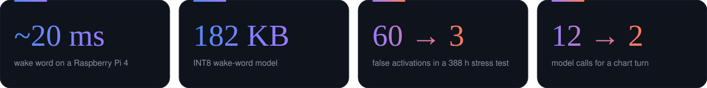

  


  


  

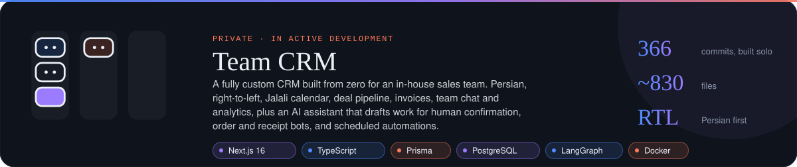

 

<a href="https://github.com/MGE-GOAT/Wake-Up"></a>
<a href="https://github.com/MGE-GOAT/MGE_GOAT">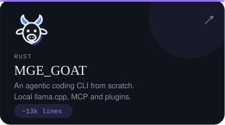</a>
<a href="https://github.com/MGE-GOAT/Ebpf-Syscall-Anomaly-Detector">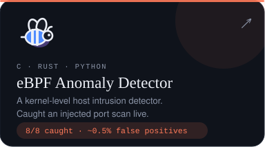</a>
<a href="https://github.com/MGE-GOAT/Polyglot-Graphrag-Security-Assistant">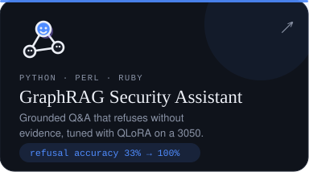</a>
<a href="https://github.com/MGE-GOAT/Int8-Keyword-Spotting-Tinyml">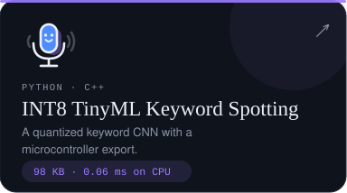</a>
<a href="https://github.com/MGE-GOAT/Deep-Rl-Cpu-Governor">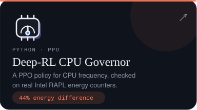</a>

  

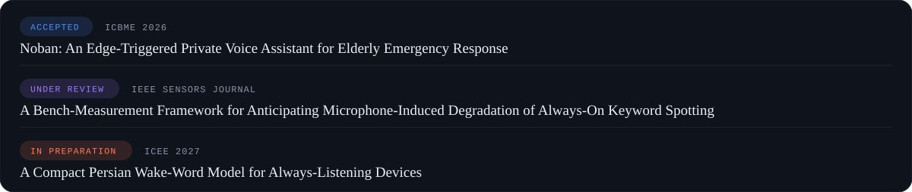

  

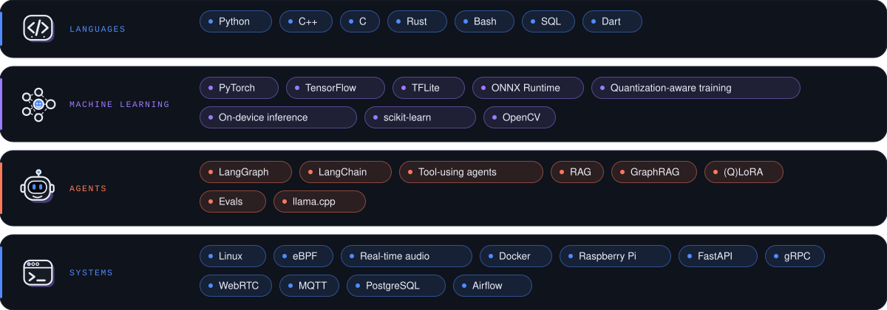

  

