<picture>
  <source media="(prefers-color-scheme: dark)" srcset="assets/banner-dark.svg">
  
</picture>

I build AI that runs on the device, close to the metal, and agents that answer from real data.
Based in Tehran, open to remote work and relocation.

  <a href="https://mge-goat.github.io"><b>Website</b></a> &nbsp;·&nbsp;
  <a href="https://mge-goat.github.io/Mahrad_Ghazli_Resume.pdf">Résumé</a> &nbsp;·&nbsp;
  <a href="https://mge-goat.github.io/Mahrad_Ghazli_Academic_CV.pdf">Academic CV</a> &nbsp;·&nbsp;
  <a href="mailto:mge.goat@gmail.com">mge.goat@gmail.com</a>

 

### Now

|  |  |
|---|---|
| **Noban** | An assistant that calls for help when an elderly person falls or needs it. Sole engineer of the device, the app and the server. Fall detection, wake word, distress sounds and voice commands all run on a Raspberry Pi, and the server only signals and relays. |
| **Peekage** | Applied AI Scientist. Rebuilt PeekAI's core as one tool-using agent where code computes every number, and built the Audience and Context agents of a chat that designs surveys. |
| **Research** | Always-on keyword spotting, microphone domain shift and tiny quantized models. M.Sc. at Sharif University of Technology. |

 

### Numbers I can stand behind

<table>
  <tr>
    <td align="center"><b>~20 ms</b> wake word on a Raspberry Pi 4</td>
    <td align="center"><b>182 KB</b> INT8 wake-word model</td>
    <td align="center"><b>60 → 3</b> false activations in 388 h</td>
    <td align="center"><b>12 → 2</b> model calls for a chart turn</td>
  </tr>
</table>

 

### Selected work

| Project | What it is | Detail |
|---|---|---|
| [**Wake-Up**](https://github.com/MGE-GOAT/Wake-Up) | The whole Noban stack: device, server and companion app | C++ · Python · Dart |
| [**MGE_GOAT**](https://github.com/MGE-GOAT/MGE_GOAT) | Agentic coding CLI in Rust with local and remote models, MCP and plugins | ~13k lines |
| [**eBPF Anomaly Detector**](https://github.com/MGE-GOAT/Ebpf-Syscall-Anomaly-Detector) | Kernel-level host intrusion detector | 8/8 port scans caught at ~0.5% false positives |
| [**GraphRAG Security Assistant**](https://github.com/MGE-GOAT/Polyglot-Graphrag-Security-Assistant) | Grounded Q&A that refuses without evidence, tuned with QLoRA on an RTX 3050 | refusal accuracy 33% → 100% |
| [**INT8 TinyML Keyword Spotting**](https://github.com/MGE-GOAT/Int8-Keyword-Spotting-Tinyml) | Quantized keyword CNN with a microcontroller export | 98 KB, 0.06 ms on CPU |
| [**Deep-RL CPU Governor**](https://github.com/MGE-GOAT/Deep-Rl-Cpu-Governor) | PPO policy for CPU frequency, checked on real energy counters | 44% energy difference |

 

### Papers

- **Noban: An Edge-Triggered Private Voice Assistant for Elderly Emergency Response**. ICBME 2026
- **A Bench-Measurement Framework for Anticipating Microphone-Induced Degradation of Always-On Keyword Spotting**. IEEE Sensors Journal, under review

 

Python · C++ · Rust · C · Bash · SQL · Dart &nbsp;|&nbsp; PyTorch · TensorFlow Lite · ONNX Runtime · LangGraph · llama.cpp &nbsp;|&nbsp; Linux · eBPF · Docker · gRPC · WebRTC · PostgreSQL
